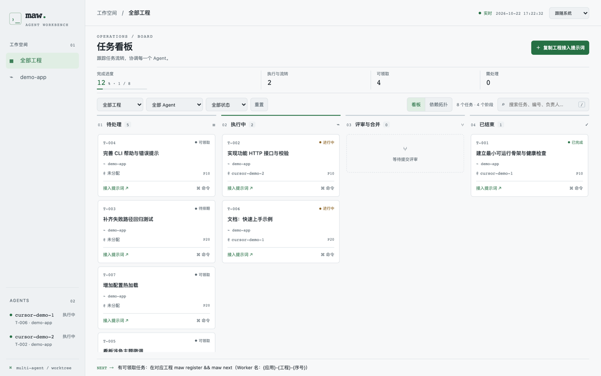

# maw

[](https://github.com/kiwh77/maw/actions/workflows/ci.yml)
[](LICENSE)
[](https://go.dev/)

**本机多 Agent 任务中枢**（Multi-Agent Workspace）。单二进制 CLI：编排并行开发、跨工程汇聚状态；规划中支持客户端状态栏实时通知。

### 适用场景

1. **多 Agent 并行领题执行** — 规划好任务清单后，在多个 Agent 会话中分别领取并落地；兼容 Codex、Cursor、WorkBuddy、Qoder、Trae 等主流客户端。
2. **本机 Agent 任务看板** — 作为本机统一看板，即时查看各 Agent 的领取、进行中与完成状态，跨工程一眼掌握进度。

设计见 [docs/DESIGN.md](docs/DESIGN.md)，路线图见 [docs/ROADMAP.md](docs/ROADMAP.md)。Python 原型保留在 `legacy/python/`。

## 能力概览

| 能力 | 状态 |
| --- | --- |
| 蓝图拆题、持久 worktree、领取 / 提交 / 合并、写盘范围检查 | 已交付 |
| 全局状态库 + 跨工程看板（`maw board`） | 已交付 |
| 跨工程 Agent 状态汇聚 | [规划](docs/ROADMAP.md) |
| 客户端状态栏实时通知 | [规划](docs/ROADMAP.md) |

## 安装

需要 **Go 1.26+**（与 `go.mod` 一致）：

```bash
git clone https://github.com/kiwh77/maw.git
cd maw
./install.sh
# 安装到 ~/.local/bin/maw（CGO_ENABLED=0）
maw --version   # 0.4.0+
```

或：

```bash
go install github.com/kiwh77/maw/cmd/maw@latest
```

手动构建：

```bash
CGO_ENABLED=0 go build -o maw ./cmd/maw
```

## 多工程与全局看板

- **状态库**：`~/.maw/maw.db`（可用 `MAW_GLOBAL` 覆盖目录）
- **工程本地**：各仓库 `.multiagent/` 只存 `config.toml` / `blueprint.toml` / hooks 相关
- **接入**：在任意仓库 `maw init` 即登记到全局库；旧版 `.multiagent/maw.db` 会自动迁移一次
- **看板**：`maw board --serve` 为全系统视图，可按工程 / Agent / 状态筛选；深浅主题、SSE 实时更新（[设计体系](docs/BOARD_DESIGN.md)）
- **优先级与一次压入（0.3.1）**：`write_scope` 允许重叠；激活/领取按 `priority` → `merge_order` → `id`，并尊重 `deps`
- **增量压入（0.3.2）**：`maw plan apply` 默认保留已完成/进行中任务；清空历史用 `--reset`
- **上下文亲和（0.3.5）**：同一 Agent 连续 `maw next` 时优先同链/同模块 ready
- **派活不卡槽（0.3.6）**：`maw next` 不受 `max_parallel` 限制；写盘重叠仍串行
- **统一 Agent 名（0.3.8）**：`{应用}-{工程}-{序号}`（例 `cursor-demo-1`）；可用 `MAW_APP` 覆盖
- **每 Agent 持久 worktree（0.4.0）**：`.worktrees/{agent}` 跨题复用；残留用 `maw prune`

蓝图规范：[docs/TASK-SPEC.md](docs/TASK-SPEC.md)，示例：[templates/blueprint.example.toml](templates/blueprint.example.toml)。  
Agent Skills（Cursor 等）：[skills/](skills/README.md)（`maw` / `maw-init` / `maw-task-list` / `maw-plan-push` / `maw-task-pull`）。

```bash
maw board --serve          # 默认 http://127.0.0.1:7420/
maw board --project <工程ID> --agent cursor-demo-1 --status in_progress
```



## 快速上手

```bash
cd /path/to/your-git-repo
maw init
# 编辑 .multiagent/blueprint.toml 后：
maw plan apply .multiagent/blueprint.toml --yes

maw register          # 如 cursor-demo-1
# 或：export MAW_AGENT=cursor-demo-1
maw next
# 进入输出的 worktree，改 write_scope 内文件并 commit
maw progress -m "里程碑"
maw submit
maw merge --yes
maw next              # 仍有 ready 则继续

maw board --serve     # http://127.0.0.1:7420/
```

## 命令

| 命令 | 说明 |
| --- | --- |
| `maw init` | 登记工程到全局库；写入多 Agent 协议规则 |
| `maw plan apply / check` | 蓝图校验与落盘 |
| `maw next` | 领取任务 + 复用/创建持久 worktree |
| `maw submit` | 范围检查 → 合并队列 |
| `maw merge --yes` | 串行合入；保留 worktree、删题分支 |
| `maw prune` | 清理残留（默认预览，`--yes` 删除） |
| `maw board` | 终端摘要 + HTML |
| `maw board --serve` | 本地 HTTP 全局看板 |

附属：`register`、`agents`、`progress`、`doctor`、`review`、`block`、`task`、`hook`。全局：`--json`、`--dry-run`、`-C`。

## 测试

```bash
go test ./...
```

## 贡献与安全

见 [CONTRIBUTING.md](CONTRIBUTING.md)、[SECURITY.md](SECURITY.md)、[CODE_OF_CONDUCT.md](CODE_OF_CONDUCT.md)。变更记录：[CHANGELOG.md](CHANGELOG.md)。

## 技术栈

- Go + [cobra](https://github.com/spf13/cobra)
- 纯 Go SQLite：[modernc.org/sqlite](https://pkg.go.dev/modernc.org/sqlite)（无 CGO）
- TOML：pelletier/go-toml

## License

[MIT](LICENSE)
