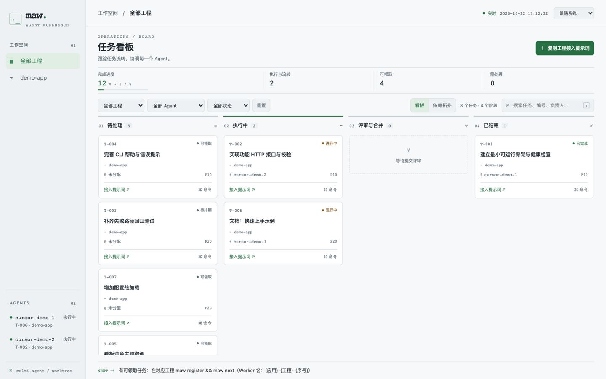

# maw

[](https://github.com/kiwh77/maw/actions/workflows/ci.yml)
[](LICENSE)
[](https://go.dev/)

> Languages: **English** | [简体中文](README.zh-CN.md)

**Local multi-agent task hub** (Multi-Agent Workspace). A single Go CLI binary to orchestrate parallel development and aggregate status across projects; the desktop app (Tauri) reuses the board page with system-tray notifications.

### When to use it

1. **Parallel agent execution** — After you plan a task list, claim and land work in multiple agent sessions. Works with Codex, Cursor, WorkBuddy, Qoder, Trae, and similar clients.
2. **Local agent task board** — One board for claim / in-progress / done across repos.

Design: [docs/DESIGN.md](docs/DESIGN.md). Roadmap: [docs/ROADMAP.md](docs/ROADMAP.md). Python prototype: `legacy/python/`.

## Capabilities

| Capability | Status |
| --- | --- |
| Blueprint tasks, persistent worktrees, claim / submit / merge, write-scope checks | Shipped |
| Global DB + cross-project board (`maw board` / `maw serve`) | Shipped |
| Cross-project status inject (`maw status report` / `POST /api/status`) | Shipped |
| Rich event feed (`/api/feed`, SSE `event` frames) | Shipped |
| vNext workbench views (13 views, project/detail panes, read-only static export) | Shipped |
| Read-only observability API (`timeline` / `activity` / `sessions` / `analytics` / `notifications`, capabilities, SSE stream) | Shipped |
| Tauri desktop shell + tray notifications | [Shipped — macOS only](clients/desktop/README.md) |
| English / Chinese docs, board UI, CLI, protocol, skills | Shipped |

## Support scope

The default and only mode is the **manual loop**: agents claim, commit, submit, and merge themselves.
Lead / System / Managed scheduling was removed; the board is observation-only and does not auto-dispatch.

Capability tiers are evidence-based, not aspirational: **verified** (end-to-end evidence), **experimental**
(interface + unit tests, no end-to-end evidence, needs prerequisites), **unsupported** (no evidence, never
enabled).

- Operations guide: [docs/operations/vnext/operations-guide.zh-CN.md](docs/operations/vnext/operations-guide.zh-CN.md)
- Upgrade & migration: [docs/operations/vnext/upgrade-notes.zh-CN.md](docs/operations/vnext/upgrade-notes.zh-CN.md)
- Platform matrix (single source of truth): [docs/verification/vnext/release/platform-matrix.zh-CN.md](docs/verification/vnext/release/platform-matrix.zh-CN.md)

Ask the runtime instead of the docs:

```bash
curl -s http://127.0.0.1:7420/api/runtime | jq .
```


## Install

### Prebuilt binaries (recommended)

Download a `maw_*` archive from [Releases](https://github.com/kiwh77/maw/releases), unpack, and put it on your `PATH`:

```bash
# Example: macOS Apple Silicon
tar -xzf maw_0.5.0_darwin_arm64.tar.gz
install -m 755 maw_0.5.0_darwin_arm64 ~/.local/bin/maw
maw --version
```

Verify with `checksums.txt` and `sha256sum -c` (or `shasum -a 256 -c`).

### From source

Requires **Go 1.26+** (see `go.mod`):

```bash
git clone https://github.com/kiwh77/maw.git
cd maw
./install.sh
# Installs to ~/.local/bin/maw (CGO_ENABLED=0)
maw --version   # 0.5.0+
```

Or:

```bash
go install github.com/kiwh77/maw/cmd/maw@latest
```

Manual build:

```bash
CGO_ENABLED=0 go build -o maw ./cmd/maw
```

## Multi-project & global board

- **State DB**: `~/.maw/maw.db` (override with `MAW_GLOBAL`)
- **Per repo**: `.multiagent/` holds `config.toml` / `blueprint.toml` / hooks only
- **Onboard**: `maw init` registers the repo; legacy `.multiagent/maw.db` migrates once
- **Board**: `maw board --serve` is the system-wide view with project / Agent / status filters; light/dark themes and SSE ([design](docs/BOARD_DESIGN.md)). Switch UI language in the page (中 / EN).
- **Locale**: `MAW_LANG=en|zh` (else `LANG` / `LC_*`, default **en**) for CLI, terminal board, and protocol text injected by `maw init`
- **Priority & one-shot apply (0.3.1)**: overlapping `write_scope` allowed; activate/claim by `priority` → `merge_order` → `id`, respecting `deps`
- **Incremental apply (0.3.2)**: `maw plan apply` keeps done/in-progress; use `--reset` to wipe
- **Context affinity (0.3.5)**: repeated `maw next` prefers same chain/module
- **No parallel slot block (0.3.6)**: `maw next` ignores `max_parallel`; write-scope overlap still serializes
- **Unified agent names (0.3.8)**: `{app}-{project}-{n}` (e.g. `cursor-demo-1`); override with `MAW_APP`
- **Persistent worktree per agent (0.4.0)**: `.worktrees/{agent}` reused across tasks; prune leftovers with `maw prune`

Blueprint spec: [docs/TASK-SPEC.md](docs/TASK-SPEC.md). Example: [templates/blueprint.example.toml](templates/blueprint.example.toml).  
Agent Skills: [skills/](skills/README.md) (`maw` / `maw-init` / `maw-task-list` / `maw-plan-push` / `maw-task-pull`).

```bash
maw serve                  # recommended local hub (= board --serve)
maw board --serve          # default http://127.0.0.1:7420/
maw status report -m "coding" --phase code --pct 40
# or: curl -sX POST http://127.0.0.1:7420/api/status -d '{"actor":"cursor-demo-1","message":"hi"}'
```



## Quick start

```bash
cd /path/to/your-git-repo
maw init
# Edit .multiagent/blueprint.toml then:
maw plan apply .multiagent/blueprint.toml --yes

maw register          # e.g. cursor-demo-1
# or: export MAW_AGENT=cursor-demo-1
maw next
# Enter the printed worktree, edit write_scope files, commit
maw progress -m "milestone"
maw submit
maw merge --yes
maw next              # continue if ready tasks remain

maw board --serve     # http://127.0.0.1:7420/
```

## Commands

| Command | Description |
| --- | --- |
| `maw init` | Register project; install multi-agent protocol rules |
| `maw plan apply / check` | Validate and apply blueprints |
| `maw next` | Claim a task + reuse/create persistent worktree |
| `maw submit` | Scope check → merge queue |
| `maw merge --yes` | Serial merge; delete worktree and task branch |
| `maw prune` | Clean leftovers (preview; `--yes` deletes) |
| `maw board` | Terminal summary + HTML |
| `maw board --serve` / `maw serve` | Local hub (board + status + SSE) |
| `maw status report` | Inject progress/heartbeat into the hub |

Also: `register`, `agents`, `progress`, `doctor`, `review`, `block`, `task`, `hook`. Global flags: `--json`, `--dry-run`, `-C`.

Desktop (Tauri, reuses board page): [clients/desktop/](clients/desktop/README.md).

## Tests

```bash
CGO_ENABLED=0 go test ./...                                   # Go core + cross-process integration
node --test internal/board/page.test.cjs                      # page assembly, view registry
npm --prefix tests/browser test                               # real-browser acceptance
python3 -m unittest discover -s docs/operations/vnext -p 'test_*.py'   # ops docs vs. code
```

The ops-doc suite fails if the operations guide drifts from `internal/app/runtime.go` (capability levels),
from the platform matrix (managed platforms), or if the upgrade notes lose a required step
(stop old writers / consistent backup / recovery / `unknown` resolution / downgrade refusal).

## Contributing & security

See [CONTRIBUTING.md](CONTRIBUTING.md), [SECURITY.md](SECURITY.md), [CODE_OF_CONDUCT.md](CODE_OF_CONDUCT.md). Changelog: [CHANGELOG.md](CHANGELOG.md).

## Stack

- Go + [cobra](https://github.com/spf13/cobra)
- Pure Go SQLite: [modernc.org/sqlite](https://pkg.go.dev/modernc.org/sqlite) (no CGO)
- TOML: pelletier/go-toml

## License

[MIT](LICENSE)
