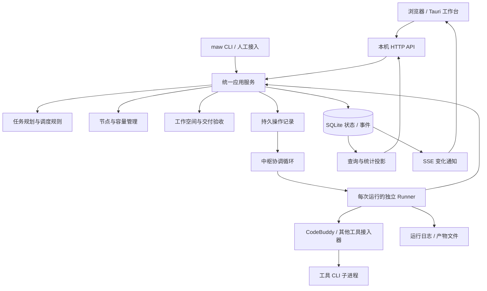
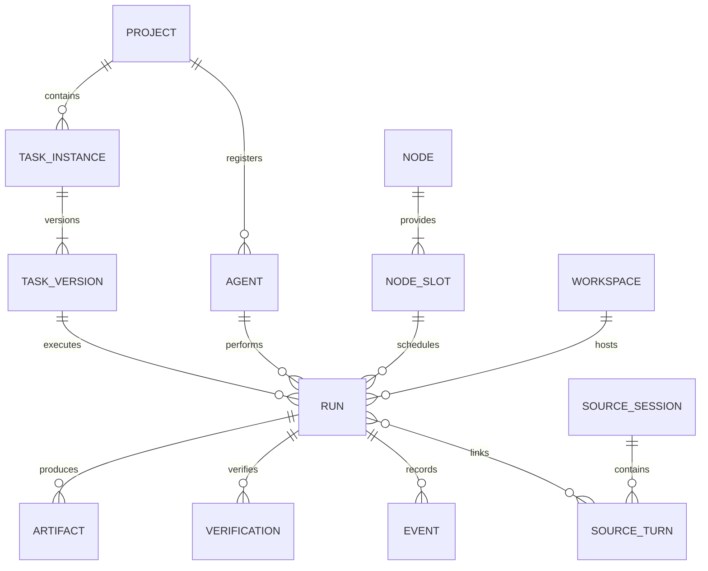
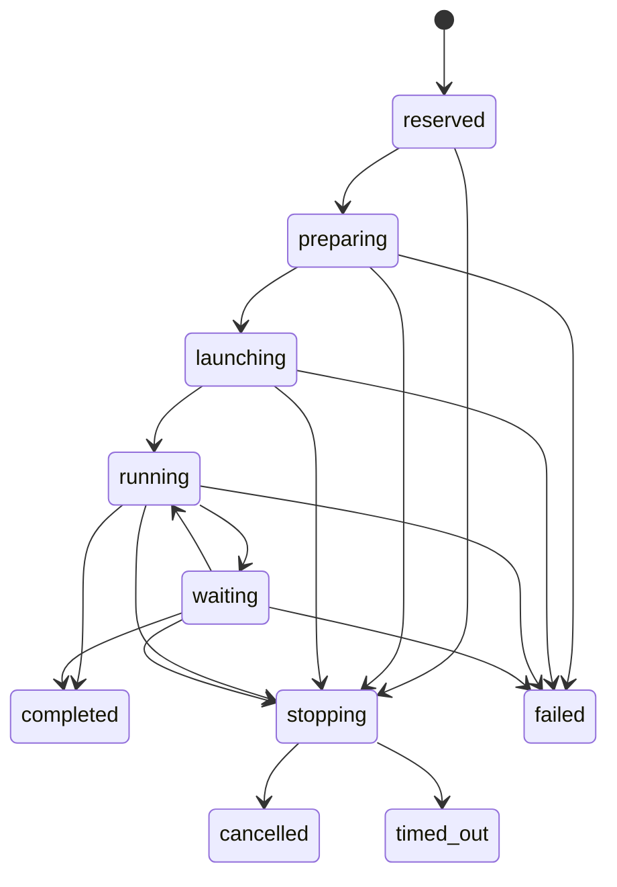

# maw 综合需求架构规划

版本：规划稿 v1.1，2026-10-23。范围：覆盖 [综合功能清单 F01–F48](maw_integrated_feature_list.zh-CN.md)，供架构评审；不包含开发任务拆分、Sprint、排期或实施操作。

v1.1 纳入用户提供的可行性评审：明确完整目标与首个受管闭环范围、自动执行的前置约束、稳定实例身份的增量存储方式，以及按平台／能力控制启用的条件。评审处置见第 17 节。

## 1. 规划前提与证据边界

用户已确认 **CodeBuddy 命令行经过手动测试，可以运行**。本方案据此将 CodeBuddy 国内站 CLI 作为首个受管执行来源，不再把此前测试中的登录要求列作当前阻塞。本轮未重复执行 CLI。用户验证不自动等同于取消、恢复、流事件和 Token 字段都已完成接入验收。

两个需求来源合并为一条产品链：

**工程与任务 → 节点匹配 → 领取／派发 → 受管执行或人工接入 → 产物验收 → 时间轴与复盘。**

现有 Go 单二进制、SQLite 全局状态库、蓝图调度、持久 worktree、HTTP/SSE 看板和 Tauri 桌面壳继续作为基础。系统面向单用户、本机多工程；不引入云端账号、跨机器调度或平台额度统一结算。

以下接口、状态和表结构均是建议的目标设计，不是现有实现描述。厂商输出字段尚未拿到实际样本的部分明确留在接入器映射层。

F01–F48 是完整产品目标，不是一次发布必须同时建成的最低集合。按全量范围实现属于大版本产品演进；复用既有调度与交付规则，并不意味着对账、迁移及接口授权的成本很小。首个可独立成立的受管闭环边界见第 17 节。

## 2. 关键架构决策

| 决策 | 推荐方案 | 原因 |
| --- | --- | --- |
| 系统形态 | 模块化单体；一个 Go 代码库、一个业务核心 | 复用现有部署与 CLI，无需微服务通信和额外基础设施 |
| 执行进程 | 中枢协调；每个受管运行由独立 Runner 进程监督，Runner 仍来自同一个 maw 二进制 | Web 服务或桌面退出时，不把执行状态和输出管道一并丢失 |
| 事实存储 | SQLite 中保存当前业务状态与追加事件；文件系统保存大体量日志和产物 | 延续本地使用；避免数据库承载逐 token 流和大文件 |
| 状态权威 | 业务状态由应用服务事务更新；事件与状态在同一事务落库 | 现有工程已经是状态表模型，不改造成全量事件溯源系统 |
| 统计来源 | 时间轴与汇总是事件／事实记录的可重建投影 | 读模型可重算、可解释，不反向控制任务调度 |
| 调度入口 | 人工 next、指定派发、自动匹配共用一组选择与领取规则 | 防止两套队列绕过依赖、容量或写盘约束 |
| 多工具接入 | 内置、版本化的接入器；节点是接入器的配置实例 | 避免一款 App 对应一套中枢；当前不开放任意第三方执行插件 |
| 兼容方式 | 保留现有命令体验与旧只读 API；内部逐步收敛到统一服务 | 用户无需因增加自动派发而放弃主动领取 |
| 前端形态 | 保留内嵌 Web 工作台，拆分静态模块与共享组件；Tauri 复用同一界面 | 不新增另一套业务 UI，也不为本轮需求强制更换前端框架 |
| 控制与观测 | 受管执行可以受控；人工／旁路接入只能声明已验证能力 | 能看到状态，不代表有能力停止该客户端 |
| 默认策略 | 自动派发须显式启用；节点自动执行容量默认 1，其他限制可配置 | 接入节点与允许无人值守执行是两个不同动作 |

## 3. 总体结构与进程边界



进程职责：

- **中枢 `maw serve`**：API、调度协调、持久操作消费、查询投影和通知。不把任务生命周期放在某个 HTTP 请求或浏览器连接里。
- **Runner**：每个受管运行一个实例，保存工具输出、监督实际子进程、归一化语义事件、执行取消、上报完成事实。不自行选择下一题、改变验收标准或决定任务 done。
- **工具子进程**：按固定 LaunchSpec 执行本次输入，使用自身正常认证机制。厂商会话不成为 maw 任务的权威状态。
- **普通 CLI／人工客户端**：可直接调用同一应用服务库并写本机数据库，不强制要求 HTTP 中枢在线才能领取。自动派发与 UI 控制需要中枢协调循环工作。

Runner 与中枢使用本机 SQLite 中的运行记录、控制操作和追加事件协作；不要求再启动一个独立消息队列或第二个常驻服务。Runner 可以在中枢暂时离线时继续保存输出和更新运行事实。仅授权的本机 maw 进程使用数据库，外部厂商 CLI 不获得修改中枢数据库的职责。

同一全局状态目录只有一个活动协调者，通过本机排他锁及操作租约约束；不能因改了 HTTP 端口就同时运行两个派发循环。普通 CLI 与 Runner 仍可作为受约束的并发状态写者。

### 3.1 模块职责

| 逻辑模块 | 负责什么 | 不负责什么 |
| --- | --- | --- |
| Task / Planning | 任务定义、版本、依赖、人工与自动共同的可领取条件 | 不启动厂商进程 |
| Node Registry | 节点配置、能力、就绪度、执行槽、探测证据 | 不保存平台密码或购买额度 |
| Dispatch / Operations | 原子绑定任务与资源，记录派发／取消／验收等操作，协调副作用 | 不把 HTTP 超时视为执行失败 |
| Runner / Supervisor | 本次运行、进程控制、输出日志、退出事实、状态对账 | 不按模型自述直接完成任务 |
| Adapters | 探测、构造参数、解析来源事件、解释结果与恢复条件 | 不直接写任务表或绕过验收 |
| Workspace | worktree／独立目录、基线、工作目录占用与归档 | 不把 write_scope 当作操作系统沙箱 |
| Verification / Delivery | 产物清单、验证证据、评审、提交与串行合入 | 不接受来源输出自行扩张验证权限 |
| Event / Query | 事件摄取、去重、分页、时间轴、统计与完整性 | 不反向覆盖业务状态 |
| Notification | 需要介入和关键交付的通知、去重与历史 | 不以实时连接建立为通知消费者已确认 |
| Transport / UI | HTTP、CLI 兼容、界面状态、详情与交互 | 不实现自己的调度或统计算法 |

这些是代码与依赖边界，不是拆分后的开发任务或独立服务。现有 `internal/app` 可继续承担用例入口，逐步调用上述模块；`internal/schedule`、`machine`、`gitops`、`scope` 的成熟规则应复用。

## 4. 领域对象：任务、节点、执行和会话分开

| 对象 | 稳定身份与含义 |
| --- | --- |
| Project | 本机工程，关联 Git 仓库或独立产物根目录 |
| TaskInstance | 一项业务任务的不可复用内部 ID；`T-001` 是便于阅读的显示编号 |
| TaskVersion | 目标、输入、读写范围、依赖、验收方式和工具要求的不可变版本 |
| Node | 全机可调度的客户端实例，关联接入器、入口、配置档与就绪证据 |
| NodeSlot | 节点可并发执行的位置，是调度资源；不是平台账户额度 |
| Agent | 工程内工作者，继续使用现有应用／工程／序号命名；可以关联节点槽 |
| Workspace | 实际工作目录及 Git 基线、分支、占用情况 |
| Run | 一次实际执行尝试；绑定任务实例及定义版本、工作者、节点与目录 |
| Operation | 请求执行某种副作用的持久记录，包含幂等键、当前步骤、所有者与结果 |
| SourceSession / Turn | 厂商会话与轮次，按来源命名空间识别，供关联与观测 |
| Artifact / Verification | 产物快照和针对确定产物／提交的验证证据 |
| Event | 不可变业务或运行事实，带来源、发生时间、接收时间与质量 |

主要关系：



受管 Run 主归属一项任务。任务可以有多个 Run；重试和显式恢复均创建新 Run，并记录前驱关系。一个厂商会话可以跨多个 Run，旁路会话／轮次也可能涉及多个任务；关联不明确时保留未归属，不能强制猜测。

运行冻结 TaskVersion、有效配置、接入器版本、CLI 版本、基线提交和验证策略。蓝图更新活跃任务时产生新定义版本，不改变已经启动的 Run 的验收标准和输入；后续执行何时采用新版本由业务状态与用户操作决定。

## 5. 节点与接入器设计

### 5.1 节点配置与动态状态

节点配置包含：`node_id`、展示名、`adapter_kind`、绝对入口路径、运行时路径、配置档引用、接入模式、是否接收新任务、槽数、工具／项目适用范围、超时与执行权限配置。

动态状态分为四个维度，不塞进一个 online 字段：

| 维度 | 取值示例 | 调度意义 |
| --- | --- | --- |
| 入口与运行时 | ready / missing / incompatible / unknown | 缺失或不兼容时不能自动启动 |
| 认证与模型 | ready / needs-login / needs-model / unknown | 未就绪说明原因；探测有时效，不缓存成永久可用 |
| 连接与心跳 | fresh / stale / disconnected / unknown | 只表明观测状态，不证明进程已停止 |
| 容量与接收策略 | available / occupied / draining / disabled | 决定是否接新任务；draining 不打断已有执行 |

能力同时保存声明值、验证值、CLI 版本和最近验证时间：非交互启动、结构化事件、会话关联、轮次、用量、取消、恢复、明确等待和运行期沙箱。版本变化使相关验证失效或需重新确认，不自动继承旧版本的所有能力。

接入模式：`managed_cli`（maw 拥有进程控制）、`manual_client`（人工领取与交付）、`observed_only`（旁路上报与回顾）。容量硬约束适用于受管／已纳管领取；对系统外自行启动的进程只能标注观测范围，不能声称控制了全机真实并发。

### 5.2 接入器契约

| 逻辑操作 | 输入与输出 |
| --- | --- |
| Probe | 输入节点配置；输出入口、版本、就绪情况、能力及证据，不触发自动登录或模型任务 |
| BuildLaunchSpec | 输入冻结的 RunSpec；输出 executable、参数数组、cwd、输入方式、允许环境引用和预期输出协议 |
| DecodeRecord | 输入有稳定日志位置的来源记录；输出零个或多个标准语义事件与原始记录引用 |
| InterpretResult | 联合结构化最终结果、错误、退出码和超时信息，输出运行结果与产物候选 |
| ResolveResume | 仅在已验证支持时，返回明确会话的恢复参数与隔离条件；不选择“最近一次会话” |

进程创建、停止和资源释放属于 Supervisor，不由每个接入器各做一套。接入器是可单测的协议适配层；目标先内置于 Go 程序，通过版本化能力表兼容来源变化。

### 5.3 CodeBuddy 的架构位置

CodeBuddy 国内站独立 CLI 是首个正式接入器目标，使用已验证可运行的本机命令入口与其自身认证。来源配置引用国内站档案，maw 不重新实现登录或挪用 WorkBuddy 桌面凭据。

启动采用已核实的非交互、结构化输出能力；任务输入走 stdin 或受控文件／参数，不拼成 shell 命令。具体流事件字段、成功标记、等待与用量映射按安装版本的实际输出固化，当前不伪造其 JSON schema。

本机历史测试已证明 CodeBuddy 认证失败可能退出 0，因此成功判定必须包含可识别的最终结果、应用错误判断及产物检查。仅有退出码 0、未知格式输出或缺失最终结果，都不能作为交付通过依据。

WorkBuddy 两个发行包可复用同系列协议解析，但节点配置、认证与能力分别验证。Trae、ZCode 等通过同一契约扩展；不把 IDE 的 chat 启动入口默认当作可回收结果的后台执行器。

## 6. 统一调度与资源约束

自动选择和指定任务派发都调用同一个 `ClaimExecution` 用例；现有 next 作为兼容入口调用该用例，不再另写领取规则。指定任务不能内部再次 next 选中另一题。

选择顺序：工程／任务策略与终态约束 → 依赖满足 → 写盘及共享文件冲突 → 工具与能力匹配 → 节点就绪与接收策略 → 容量与目录可用 → 优先级／合入序位／上下文亲和 → 稳定编号作为最终顺序。

一次短事务完成以下一致性边界：

1. 验证预期 TaskVersion 与当前 revision，确认没有冲突的活跃 Run。
2. 占用节点槽、预定工作目录及必要写盘资源。
3. 创建 Run 和持久派发 Operation，将任务标为已领取。
4. 追加相应事件，一起提交。

Git 操作、工作目录准备、进程启动和验证命令都在事务外执行，通过 Operation 记录步骤、重试和对账。事务失败时没有已认可的领取；副作用结果不确定时进入核实，不能重新起一个相同进程来“重试事务”。

约束分开管理：

- **执行槽**：真实计算进程停止并确认后可释放。
- **工作目录占用**：可持续到产物冻结、验收和合入结束，避免下一题重置尚待验收的分支。
- **工程写盘与合入约束**：延续现有冲突规则与工程内串行合入，不能因节点空闲而越过。
- **全局自动执行上限**：新增明确配置，不把目前只作展示参考的 `max_parallel` 偷换成新语义。
- **共享平台资源组**：仅在用户明确配置后用于容量互斥；不推断多个 App 拥有独立或共享额度。

默认沿用每 Agent 持久 worktree。节点槽在不同工程关联不同 Agent；同工程对应目录仍被验收占用时，该工作者等待，不擅自创建无限新目录。需要扩容时由明确的槽位／工作空间策略控制。

当前 `max_parallel` 的“参考展示”语义继续保留。新增配置应明确区分 `managed_execution_limit` 与各节点的 `slot_limit`；它们限制受管执行，不对未绑定受管节点的人工 next 强加新计算配额。所有领取方式仍必须遵守同一任务与目录占用规则，因此未知占用可能使原先可被超时释放的任务变为待核实。这是明确的安全语义调整，需要向用户解释，不能宣称行为完全不变。

## 7. 三套状态与完成语义

### 7.1 业务任务状态

保留已有 backlog、ready、claimed、in_progress、self_check、in_review、merging、conflict、blocked、done、cancelled。claimed 表示已绑定但未完成启动；Run 真正开始后才进入 in_progress。

代码任务仍以验收／评审和合入完成作为 done 条件。非代码任务的验收策略可以跳过不适用的合入环节，在明确的人工或机器验收通过后 done，并记录完成方式。

Run 失败不必新增业务 failed 状态：执行失败留在 Run；任务根据策略进入待处理的 blocked，或在确认原执行结束后重新 ready。业务依赖仍只认可满足完成契约的前置任务。

### 7.2 运行状态



状态图表达主路径；每条转移仍须执行身份与 revision 检查。waiting 携带可验证的原因：用户输入、授权、外部服务等，不因无输出自动产生。

`completed` 只表示运行协议已完成并产生可判定结果，尚不代表验收通过。`failed`、`cancelled`、`timed_out` 均是保存了相应证据的运行结果；资源是否可复用另看停止与工作目录确认。

为避免状态爆炸，另外保存 `desired_action`、`reconciliation_state`、`process_stop_confirmed`。心跳丢失产生 `reconciliation_state=unknown`，不直接伪造 failed 或 cancelled，也不自动释放写入目录。

### 7.3 交付与验收状态

产物候选 → 待验证 → 验证通过／失败／需要人工确认 → 按策略评审 → 合入或非代码接受。验证针对确定的任务版本和产物／提交哈希；产物变化后旧验证失效。

“停止本次运行”和“取消业务任务”是不同操作。前者保留任务和已有结果，等待重试／处置；后者须先使活跃 Run 停止并核实资源，再把业务任务置 cancelled。

## 8. Runner、可靠启动与恢复

Runner 使用固定 RunSpec，持有每 Run 的本机排他执行锁和代际标识，在启动工具前再次验证绑定。两个相同 Run 的启动请求只能有一个获得执行资格；已发出启动但未收到确认时保持 pending／unknown，先检查 Runner 锁与执行证据。

启动前保存将要执行的规格摘要与启动意图，启动后保存进程身份和开始事件。进程身份包含 PID、启动身份／时间以及本次运行 nonce；不能只根据一个 PID 判定进程归属。文件锁、进程监督和停止行为由平台实现承担，按 macOS／Linux／Windows 分别验证契约，不声称一个通用 kill 能清理所有后代进程。

输出由 Runner 直接追加到受限访问的运行目录，不通过内存管道长期积压。语义记录附本地序号和稳定文件位置；数据库暂不可写时先在本机日志保留待补交记录。恢复后按幂等键补交，而非重发模型任务。

中枢重启后从持久 Operation、Run、资源占用、Runner 身份和日志游标核实情况：

| 情况 | 处理原则 |
| --- | --- |
| Runner 和工具仍可确认运行 | 恢复查询与控制，不重新启动 |
| 进程已结束且有完整结束证据 | 补录结果，继续产物与验收链 |
| 尚未发出启动、资源和规格可确认 | 继续原 Operation 的准备步骤 |
| 是否启动／是否停止不确定 | 保留占用，标明待核实，允许人工处置 |
| Runner 死亡、工具后代是否存活不明 | 不复用该目录；核实或隔离后再重新派发 |
| 人工／旁路节点不再上报 | 显示过期／未知；依赖明确交付或人工结束确认 |

取消先写入持久 Operation 与目标状态；Runner 执行停止并记录证据。租约过期和旧 Run 代际失效只阻止过期状态提交，**不能阻止旧进程直接写文件**。无法证明旧写入进程停止时，目录保持隔离与不可重新分配。

恢复厂商会话会创建新 Run，显式指定已验证的 session ID 和前驱 Run；不自动使用全局最近会话。限流／临时网络问题可按已配置策略退避；认证、待授权、未知启动结果、未知进程状态和验收失败不会进入无限自动重试。

## 9. 工作空间与结果冻结

Git 工程继续使用 `.worktrees/{agent}`，每次执行冻结基线提交及任务分支。独立非 Git 任务使用项目产物根下的专用目录；文档属于代码仓库时仍按 Git 工作空间处理。

运行结果统一生成 DeliveryManifest：任务实例、定义版本、Run、节点、摘要、声明产物、实际文件／提交引用、CLI 结果、退出信息、验证证据和失败原因。CLI 产物声明只是候选，实际文件存在性、范围与验收由 maw 确认。

需要长期保留的非代码产物进入内容哈希存储；代码产物至少保留候选提交、基线及可恢复的补丁／归档策略。不能只记录一个会被下一题重置的 worktree 路径。冻结完成前不释放工作目录；清理不得删除仍被待验收结果引用的唯一产物。

验证命令来自冻结的工程／任务定义与用户策略，不从厂商输出中提取任意 shell 语句执行。保留手工验证入口、现有 review／merge 策略及串行合入；是否自动合入沿用显式配置，派发不等于授权自动合入。

## 10. 持久化与一致性设计

### 10.1 存储实体

下表是逻辑持久化契约，合并字段或物理表时不得丢失身份、唯一性和事务约束；不要求将每个读模型都立即物化为独立表。

| 实体／表组 | 关键内容与约束 |
| --- | --- |
| projects | 延续 ID、路径、主干；增加工程类型与非 Git 产物根。工程目录按规范化实际路径识别 |
| task_instances / tasks / task_versions / task_dependencies | task_instances 保存不可复用实例身份与退役快照；现有 tasks 保留当前任务及其物理复合主键，新增唯一 instance_id 引用；定义版本不可变，依赖指向明确实例 |
| nodes / node_slots | 全机 Node ID；节点槽编号唯一；能力与就绪状态含验证版本、来源和时效 |
| agents | 保留工程内身份唯一性；可选关联 Node／Slot；不把 Agent 名当作平台账号或会话 |
| workspaces / resource_leases | 目录、基线、分支与占用者；节点槽、目录、合入等资源分别加唯一占用约束；释放校验占用代际 |
| runs | 固定任务版本、执行模式、节点／工作者／目录、前驱 Run、配置快照、phase、结果、停止确认与核实状态 |
| operations | 类型、目标、幂等键、请求摘要、状态、步骤、处理者与租约；派发意图、取消和验收等副作用有持久查询入口 |
| events | 本地递增游标、标准事件身份、版本、对象关联、来源、发生／接收时间、质量及证据引用 |
| source_sessions / source_turns / run_source_links | 来源命名空间内的外部身份唯一；会话、轮次与 Run 显式关联，允许未归属 |
| artifacts / verification_results | 产物清单、内容哈希或提交引用、验证对象版本、命令与结果、人工结论及证据 |
| usage_records | 来源计量身份、scope、累计或增量语义、可空 Token 字段、缓存口径、原始事件引用 |
| projection_state / spans / 统计缓存 | 投影版本、处理游标与脏范围；时间区间和统计均可重建；缓存不是业务权威 |
| notification_deliveries | 通知身份、来源事件、渠道、投递／确认状态；可持久去重与查看历史 |
| schema_migrations | 明确的迁移序列、兼容读写版本与完成记录；读请求不执行 schema 修改 |

### 10.2 事务不变量

- 活跃选择入口中的 task_instances 与当前 tasks 行一一对应；实例创建、当前别名建立、退役快照和当前别名移除均在同一事务完成。当前状态只由 tasks 持有，退役快照不可变，不长期双写两份可变状态。
- 同一 TaskInstance 默认至多一个有效执行占用；unknown，以及已记录失败但进程停止尚未确认的 Run，都继续计入占用，不能仅按终态字符串判断可重派。
- 同一节点槽、工作目录或工程合入资源同时只有一个有效持有者；更换状态和释放均使用预期 revision／generation 条件。
- 新业务状态、资源变更、Operation 进展及对应事件在同一事务提交。事件追加失败不能被忽略后仍宣称状态提交成功。
- 幂等键绑定调用者、操作类型与请求内容摘要；同键同内容返回原结果，同键不同内容返回冲突。
- 并发修改任务或节点采用 revision 条件；验证和提交对旧版本产物操作时拒绝，而不是覆盖新结果。
- 本机文件与 SQLite 没有跨介质原子事务；先写可恢复意图、在文件侧保存证据、再提交完成事实，由 Operation 对账弥合中断。

持久派发 Operation 可以先处于排队状态，尚无 Run。只有满足条件且资源领取事务提交后才分配 Run ID；派发 Operation 完成表示 Runner 已按契约确认启动或接管，不代表任务完成。取消 Operation 完成表示停止已确认。验证 Operation 的执行状态与“验证通过／失败”业务结论分别返回。

取消与正常完成竞争时按持久事务确认顺序处理；如果结束事实已被确认，取消操作返回 already-finished 及原结果，不追改为 cancelled。等待节点容量的排队意图允许用户撤回，未发生启动时不需要伪造一次运行。

### 10.3 SQLite 使用方式

保留 WAL 和短写事务，允许本机 CLI、中枢与 Runner 经同一应用服务规则进行多进程写入。每进程复用 Store 连接，不按每个 API 查询重新初始化 schema。

查询使用普通只读事务／只读连接，不复用当前基于 BEGIN IMMEDIATE 的写事务助手。写入有有限等待与重试，耗尽后返回可处理错误；心跳／投影降级不应造成模型任务自动重发。大日志、Git 操作和厂商网络请求不占用数据库事务。

当前状态查询应在一致读快照内给出状态和事件水位。业务状态可以比异步统计投影新，返回中分别提供 `state_cursor`、`projection_cursor` 和投影版本，界面显示统计更新情况。

### 10.4 文件布局

```text
~/.maw/
  maw.db                         状态、运行、操作、事件与投影元数据
  auth/                          本机 API 的凭据／会话材料，限制本机访问
  runs/<run-id>/
    spec.json                    冻结规格，保留配置引用，不落账号秘密
    runner.lock                  排他运行身份
    journal.jsonl                可恢复语义记录与日志位置
    stdout.log / stderr.log      按策略脱敏和限制保留的诊断输出
    result.json                  结果与证据清单
  artifacts/<content-hash>/      需长期保留的产物快照
  backups/                       迁移与恢复备份

<git-project>/.multiagent/        继续存工程配置、蓝图和协议文件
<git-project>/.worktrees/<agent>/ 继续按工作者复用 Git 工作空间
<non-git-project>/.maw-work/      独立任务的受管工作目录
```

锁空闲并不是“该 Run 从未执行”的证明；若已有启动意图却无结束证据，必须先核实原进程。原始文件保留有大小、时间和总量限制；默认保留结构化事实、必要诊断和交付证据，完整协议／正文采集为显式选项。日志清理不删除仍在待补交的语义记录；确实丢失的数据标为不完整。

## 11. 标准事件、时间轴与计量

### 11.1 统一事件信封

| 字段组 | 设计 |
| --- | --- |
| 身份 | `event_id` 是标准事实身份；本地 `cursor` 是入库顺序；`schema_version` 是契约版本 |
| 业务关联 | project、task_instance、task_version、run、operation；按事件类型决定哪些必须存在 |
| 来源关联 | node、adapter 与版本、source_event_id、来源会话／轮次；不得把所有来源事件 ID 放在同一个未分域集合 |
| 时间 | `occurred_at`、`received_at`；UTC 高精度时间戳；保留来源精度与来源时钟说明 |
| 生命周期 | run generation、因果操作引用、本地日志序号／位置 |
| 证据与质量 | evidence_kind（运行时／来源上报／人工／旧日志）、observed／estimated／unknown、完整性与证据引用 |
| 内容 | 有类型的最小 payload；未知来源记录保留引用，不擅自投影成已完成或执行时长 |

事件类型按事实分组，例如 task.claimed、run.started、run.waiting、run.finished、artifact.collected、verification.finished、task.merged、turn.started、turn.finished、usage.reported。命名只是标准契约，不要求厂商输出同名字段。

每个 Run 的语义记录具有稳定本地序号；有厂商稳定 ID 时按来源命名空间去重，没有时按 Run、解析版本、日志位置和记录索引形成可重复的键。不简单按文本哈希去重，因为相同文本可能是两条真实独立记录。

对晚到的记录按发生时间补算受影响的 Run 和时间桶，但事件游标保持接收／入库顺序。聚合不只依赖最近一个时间桶。出现时间倒置、边界缺失或时钟不可信时，标记质量，不能静默生成负时长或随意修正为完整。

### 11.2 四种区间分开投影

| 区间 | 证据 | 可以表达什么 |
| --- | --- | --- |
| task_phase | 任务状态转移及完整边界 | 执行／评审／合入等阶段的经过时间 |
| cli_process | Runner 确认的子进程开始和结束 | CLI 运行跨度，可能包含启动和等待 |
| agent_turn / model_request | 来源明确提供且语义已核实的边界 | 对应口径的代理轮次或模型请求区间；不能混为同一种“AI 工时” |
| explicit_wait | 明确的等待开始、原因和结束 | 已观测的等待；空白和断联仍是未知 |

同一指标只汇总同一范围与口径。已知完整代理执行区间可算累计与并集；只有 CLI 进程边界时，界面应显示 CLI 运行时间。没有来源输入事件时不画“人工输入点”。

查询使用半开时间窗口 `[start, end)`，取窗口前有效状态作为边界上下文，再裁剪跨日区间。时区作为查询参数，存储仍用 UTC；本机运行可附单调时钟耗时用于识别墙钟跳变，不能把单调计数跨进程直接相减。

### 11.3 Token 与归属

usage 明确是单轮增量还是会话／运行累计快照，并带 scope 与计量口径。累计更新使用同一计量实体的新观测替代或推导差额，不能再次整体相加；重置计数和缺失前值要保留不确定性。

input、output、cache_read、cache_write 等字段可空；缓存是否已包含在 input 内由来源口径决定，未确认前不额外相加。实时采集和导入回放共享计量身份，不重复计量。

一个 Turn 关联多个 Run／任务时，来源总量按 Turn 去重。未获明确分配规则的用量进入“未分摊”，任务明细可显示共享关联，不能给每个任务各算一份完整 Token。覆盖率分母限于本系统已观测、可比较的实体，不声称覆盖未接入的所有工具。

## 12. 查询 API、实时同步与前端结构

### 12.1 统一接口边界

新接口使用 `/api/v1`，下表为资源契约方向；不是本轮要实施的接口任务表。

| 接口类别 | 代表资源 | 行为 |
| --- | --- | --- |
| 工程与任务 | `/projects`、`/tasks`、`/tasks/{instance-id}`、`/tasks/{id}/versions` | 查询、创建与版本更新；显示编号作为查找条件 |
| 节点 | `/nodes`、`/nodes/{id}`、`/nodes/{id}/probes` | 配置／禁用接收；探测由 POST 创建异步操作 |
| 派发 | `POST /dispatches` | 指定任务／可选节点／前驱恢复信息；返回 Operation，资源满足后关联 Run |
| 主动领取 | `POST /claims` | 调用同一领取用例；人工客户端使用，不绕过调度 |
| 执行与控制 | `/runs`、`/runs/{id}`、`POST /runs/{id}/cancellations` | 查询运行和申请停止；不把申请受理显示成停止成功 |
| 任务取消与重新执行 | `POST /tasks/{id}/cancellations`、`POST /tasks/{id}/retries` | 区分业务任务取消与单次 Run 停止；重试仍走资源领取 |
| 交付验收 | `/runs/{id}/deliveries`、`/deliveries/{id}/verifications`、`/tasks/{id}/reviews`、`/tasks/{id}/merges` | 产物、验证、人工结论与合入分别有持久身份 |
| 操作 | `/operations/{id}` | 查询 queued／running／succeeded／failed／unknown 与具体业务结果 |
| 旁路观测 | `POST /observations` | 接收版本化上报并验证来源绑定；不能通过观测 payload 下发命令或绕过任务归属 |
| 历史事件 | `/events?cursor=&limit=&project_id=&run_id=` | 稳定游标分页，返回 next_cursor 与 has_more |
| 时间轴与统计 | `/timeline?start=&end=&tz=&...`、`/analytics?...` | 统一口径与质量字段，返回状态／投影水位 |
| 提醒与推送 | `/notifications`、`/stream` | 持久提醒查询与 SSE 变化通知；按身份确认已处理 |

短同步资源创建返回 201；接受异步操作返回 202 与可查询位置。状态／revision 冲突返回 409；输入语义错误返回 422；认证问题返回 401／403。错误含稳定 code、可读信息、关联对象和可执行的下一步，不泄漏堆栈或秘密。

修改请求携带幂等键；有资源版本的修改还携带预期 revision。时间轴和统计的筛选语义由服务端统一，前端搜索只影响局部展示时须明确说明，不把搜索后的卡片数当作全工程统计。

### 12.2 SSE 与补拉

SSE 只提供状态变化、通知身份及事件水位。完整事实以持久事件查询为准；断线后按已消费游标补拉，直到 has_more=false，再拉一致快照。慢客户端掉帧允许通过补拉恢复，不以 SSE 成功写出证明业务已消费。

游标只能推进到服务器本次实际扫描并确认的范围，不能先读一页 200 条，再直接跳到全库最大 ID。过滤查询可以跳过已扫描的不相关事件，但 next_cursor 必须表达已扫描边界，保证匹配记录不会被漏掉。

后台投影、浏览器和通知消费者分别维护游标。通知以事件／通知 ID 去重；操作系统弹窗和数据库确认不存在原子提交，因此采用可恢复投递与去重，承认极端重启窗口可能重复，不宣称严格 exactly-once 弹窗。

### 12.3 前端模块与桌面壳

沿用共享语义 token、主题、i18n、工程导航和详情交互，将现有大页面按数据访问、工作区状态、任务视图、节点、执行详情、时间轴、统计、通知和通用组件拆成内嵌静态模块。

前端仅管理选择、筛选、路由与临时交互状态；任务状态、操作结果与聚合值来自服务端。新增写操作展示“请求已受理／执行中／完成或失败”，页面刷新可通过 Operation 恢复，不只在内存中显示成功 toast。

浏览器与 Tauri 加载同一业务页面；Tauri 增加系统通知桥与窗口行为，不持有另一份任务状态机。已有静态导出看板仍是只读快照，离线时不展示可成功执行的操作按钮。

## 13. 本机控制接口的信任边界

现有看板以读取和状态注入为主，增加进程启动、取消与合入后，接口必须区分“可被本机网络访问”与“被用户授权调用”。

- 默认只绑定 loopback，严格校验 Host 与请求来源，不接受任意 CORS。非本机网络部署不属于本方案默认模式。
- 本机 CLI 使用受限权限文件中的随机令牌；浏览器／WebView 使用同源本机会话与 CSRF 防护。浏览器首次顶层访问可建立本机会话，跨站嵌入／脚本请求不能据此获得执行权限；精确引导策略和来源校验作为接口契约的一部分。
- 浏览器修改请求使用 JSON、同源检查和 CSRF 标记；SSE 随本机会话鉴权。令牌不进入 URL、日志或蓝图。
- 接入器入口是登记过的可信绝对路径，运行参数由类型化规格生成，不执行模型输出拼成的 shell。
- 厂商认证仍由厂商 CLI 管理。数据库保存配置引用与就绪证据，不集中复制各工具的 token。
- 产物打开／下载限定在已关联工作空间与归档路径；日志和输出在界面按文本安全渲染。文件系统权限与沙箱能力按节点明确展示。
- 原始协议可能包含正文或上下文，默认采集最小化；秘密字段过滤和采集／保留配置作用于写入前，而不是仅在 UI 隐藏。

令牌与来源校验主要约束跨站网页、未获令牌的 API 调用者以及文件权限能够区分的系统用户。它不构成对已控制同一系统用户权限之进程的强隔离：该进程可能读取用户令牌、直接调用工具或访问用户数据库。需要对同用户恶意进程建立边界时，应另外采用系统沙箱或独立账户；本方案不把本机令牌描述为这种隔离能力。

这些是从只读看板扩展为本机执行控制后的架构要求，不新增云端账户或角色组织体系。

## 14. 兼容、迁移与现有代码衔接

### 14.1 复用与调整边界

| 现有入口／模块 | 架构处理 |
| --- | --- |
| `internal/app`、CLI 的 next／submit／merge | 保留用户入口，收敛到共同的任务、执行与验收用例 |
| `internal/schedule` | 复用依赖、范围与亲和性；外层增加节点能力与资源领取 |
| `internal/machine` | 保留业务任务词汇，增加独立运行／交付状态机，收紧非法跨状态迁移 |
| `internal/gitops`、`scope` | 复用 Git 与范围能力；调用从 DB 长事务中分离，并受工作目录／合入资源约束 |
| `internal/db` | 增加受版本控制迁移、读写分离、稳定实例与运行实体；明确事务内事件失败处理 |
| `internal/board` | 提供查询与操作传输边界；扩展时间轴与节点 UI，不把执行控制塞进模板函数 |
| `status report` / `/api/status` | 保留进度与存在性兼容；验证归属，不能靠普通上报自动占有任务或写 done |
| `internal/app/heartbeat.go` | 过期转为核实，不继续对受管 Run 使用“超时就释放并重派”语义 |
| Tauri | 复用本机 UI，业务事实留在中枢；退出桌面窗口不等于取消任务 |

代码依据：当前 [Next](../internal/app/worker_cmd.go:18)、[心跳恢复](../internal/app/heartbeat.go:11)、[状态上报](../internal/app/status_cmd.go:26)、[数据库助手](../internal/db/db.go:308)、[看板查询](../internal/app/helpers.go:300)、[SSE 游标](../internal/board/events.go:104)。

### 14.2 数据迁移原则

稳定实例身份与物理主键重建分开：先保留现有 tasks 的 `(project_id, id)` 物理主键，新增非空且唯一的 instance_id，引用 task_instances 的稳定身份。新 Run、版本、依赖和事件都关联 instance_id；旧显示编号入口只负责定位当前实例。这样稳定身份可以先成立，而不要求首个闭环重建全部当前任务表。

task_instances 是身份与退役归档锚点，不是另一份随时变化的任务状态表。未退役实例的可变状态来自现有 tasks；退役时将定义版本与业务状态快照写入锚点并移除当前别名，之后按快照只读。使用同一显示编号重新建题必须创建新实例，不能覆盖旧锚点。仓储接口统一返回当前状态或退役快照，调用者不自行选择两种来源。

当前任务各自生成一个稳定实例。历史中相同显示编号多次创建且无法可靠归属的事件保留 legacy 身份与 ambiguous 标记，不全部挂到当前实例；增加新 ID 本身不会恢复历史真相。当前 tasks 的物理主键是否在后续版本转换，仅作为存储优化评估，不是功能范围的必要承诺。

默认 plan apply 继续增量更新。移出计划的空闲任务归档；reset 改为显式归档并重建实例，不复用内部身份，不在活跃 Run 或未确认写入占用仍存在时直接清空任务。旧蓝图没有运行要求时按人工模式兼容。

使用版本化、可回退的数据迁移：迁移前保存含 WAL 一致性的备份；破坏性结构升级要求旧写进程停止、受管运行排空或进入明确维护状态；迁移后做身份、引用、状态和数量一致性校验。恢复是停写后回到同一版本的完整备份，不只替换一个可能缺 WAL 的文件。

不能只增加 `min_writer_version` 就宣称拦住历史 0.4.0 二进制：旧实现并不检查该字段，且会在打开时写 schema_version。新版本执行读写兼容检查；升级窗口必须同步替换使用中的 maw 命令、停止旧写者。旧二进制直接写新库不属于兼容承诺；需要读取旧状态时使用隔离备份，不能混用两个写核心。

### 14.3 API 与命令兼容

保留现有只读 `/api/board`、`/api/task`、`/api/feed` 的兼容形状，通过新查询服务适配。旧显示编号定位有歧义时要求工程／实例上下文，不继续静默选第一条。

旧状态上报迁移到本机授权与归属验证，升级后的 CLI／接入提示负责携带本机认证。缺少认证返回明确接入说明，不保留一个可绕过新控制边界的匿名写通道。旧自由载荷只作为兼容进度，不伪装成完整执行遥测。

## 15. 需求覆盖与架构校验

| 功能范围 | 架构归属 | 必须保持的不变量 |
| --- | --- | --- |
| F01–F03 工程 | Project、统一查询与前端上下文 | 工程隔离与筛选一致 |
| F04–F07 任务 | TaskVersion、Planning、类型化验收 | 已启动运行的定义不被蓝图中途改写 |
| F08–F11 节点 | Node Registry、Slot、Probe、能力证据 | 在线、认证、能力与容量不混淆 |
| F12–F16 派发 | ClaimExecution、Operations、人工兼容 | 一套调度约束，指定题不误领另一题 |
| F17–F21 执行 | Runner、独立状态与对账 | unknown 不自动释放或重启 |
| F22–F25 目录 | Workspace、资源占用、Git／目录实现 | 旧写进程未确认停止时不复用目录 |
| F26–F29 交付 | Manifest、产物快照、Verification、Review／Merge | 运行结果不等于任务 done |
| F30–F33 工作台 | Query、Operation、SSE、Notification、Tauri | 刷新与断线不丢已受理操作；推送可补拉 |
| F34–F38 时间轴 | 标准事件、分层区间、来源关联 | 任务阶段／进程跨度／真实执行分开 |
| F39–F43 统计 | usage、投影游标、统一聚合 | 同源计量去重；未知不填 0；并发不作提效倍数 |
| F44–F48 历史与设置 | 实例身份、迁移、配置、保留、共享 UI | 数据质量可见，不可恢复证据不伪造 |

架构验证场景用于判断设计是否完整，不是本轮执行的测试或任务卡：并发派发同题；领取后准备失败；启动确认前中枢中断；Runner 死亡但工具仍可能存活；取消期间重复请求；验收前目录重用；旧状态上报越权；200 条以上事件积压；跨日及乱序事件；多任务共享 Turn 的用量；旧版本迁移及结果恢复。

当前不设未经测量的性能承诺。关键预算应覆盖数据库写等待、状态新鲜度、取消确认、日志总量与投影落后程度；任一预算耗尽需显式降级，不静默丢失交付证据或重复启动模型任务。

## 16. 决策状态与仍需实现期验证的边界

**本轮推荐明确的架构基线**：模块化单体、单机 SQLite、统一领取服务、独立 Runner、版本化接入器、任务／Run／会话分离、产物独立验收、事件派生时间轴、本机授权及旧写者维护迁移。

**不阻塞架构、但不能提前背书的来源能力**：CodeBuddy 当前版本的完整流事件映射与 Token 口径；各工具的取消／恢复／授权续接；其他 App 的认证上下文；各操作系统进程树停止证据。以接入器能力与版本验证结果控制开放范围。

**保留给产品配置的选项**：允许哪些工程自动派发、节点槽数、全局容量、自动重试范围、人工验收与合入策略、采集详细程度及日志保留预算。它们不改变上述模块和数据边界。

本轮只形成架构规划和前提更新。没有拆任务、压蓝图、创建执行队列、启动模型任务、迁移数据库或实现上述模块。

## 17. 可行性评审处置与启用边界

### 17.1 评审结论采纳范围

用户提供的评审作为设计评审输入记录，不等同于已完成故障演练或厂商能力验收。本次仅复核关键现有代码路径并修订文档。

| 评审意见 | 处置 |
| --- | --- |
| 全量属于大版本／产品二代量级 | 采纳为范围判断，不给未经估算的人日或交付日期；完整实体清单不等于首发必须全部物化 |
| 核心风险是对账、迁移和 CLI 不确定性 | 采纳；作为允许启用受管执行的条件，而非最后才处理的加固 |
| 现有调度、worktree、验收等资产可复用 | 采纳；可复用规则仍须放进统一事务与资源语义，不能据此认定改造路径天然短或无风险 |
| 稳定实例 ID 必须建立 | 采纳；修订为保留 tasks 当前表主键、增加唯一实例引用与退役归档，降低初次迁移破坏面 |
| 先受管闭环、再统计和多工具 | 采纳产品范围取舍；统一领取、心跳和资源保护是受管闭环的前置组成部分，不能放到其后 |
| 多 OS 进程树停止与厂商能力不能提前承诺 | 采纳；首个受管能力以当前 macOS 和已验证 CodeBuddy 组合为验收对象，其他组合维持人工／观测模式 |
| 本机令牌阻止“本机任意进程”执行 | 校正威胁边界：它约束 API 入口，不隔离已获得同用户系统权限的进程，见第 13 节 |

### 17.2 首个可独立成立的受管闭环

这是架构范围定义，不是任务清单、实施排期或对当前功能的上线声明。

| 边界 | 首个受管闭环中的选择 |
| --- | --- |
| 来源与平台 | 当前机器上的 CodeBuddy 国内站 CLI；当前 macOS 平台。已获用户运行确认，具体自动化能力仍按实测开放 |
| 调度方式 | 用户明确指定任务／节点触发一次受管执行；受管执行全局容量与该节点容量先按 1 约束；自动匹配和连续无人值守派发仍关闭 |
| 工作对象 | 有明确范围、基线和验收方式的 Git 工程任务；独立非 Git 工作流不作为该闭环的必要条件 |
| 稳定身份 | 当前任务实例、不可变定义版本、唯一 Run、必要资源占用与 Operation；保留人工领取入口 |
| 运行链路 | 原子领取 → 工作目录准备 → Runner 监督 CodeBuddy → 收取 Manifest → 依现有策略验收／评审／合入 |
| 故障处理 | 启动结果不确定、中枢重启、Runner 异常、取消与结束竞争均有可查询结果；unknown 时不重派或重置相关目录 |
| 最低观测 | 任务阶段、CLI 运行起止、Run 状态、结果与失败证据；允许缺少 Token 和轮次，不制造“AI 工时” |
| 初始持久化 | 支撑身份、占用、操作、运行和验收所必需的结构；usage、复杂时间桶和通知投递等不必先建空表 |
| 交互 | 现有看板／CLI 能定位 Run、查看状态和交付，必要的失败与待核实处置清楚；完整热图与高级统计不作为依赖 |

首个闭环缩小的是工具、平台和展示范围，资源保护、事件一致性、授权与恢复正确性不因此省略。受管能力未通过某平台验收时，该平台保留原有人工功能，不因共享 Node 模型而自动开放受管执行。

### 17.3 架构依赖关系

**统一领取与资源语义、稳定身份／迁移边界、本机写接口授权 → CodeBuddy 受管闭环 → 可解释的时间轴投影 → 按能力扩展来源与统计。**

这里的箭头表示成立条件：所有受管执行都必须先满足共同规则。前端整理和旧只读查询可独立演进，但不能通过增加按钮绕开这些条件。事件契约与最小事实记录必须从受管闭环开始存在，不能等到绘制时间轴时才追补。

### 17.4 高代价风险的启用条件

| 条件 | 对应风险 | 未满足时的产品行为 |
| --- | --- | --- |
| G01：受管 Run 不再被旧心跳路径直接释放；节点槽和目录占用唯一，停止证据可查 | 旧进程未停就复用／重置目录 | 不开放受管派发；明确显示被哪个占用与原因阻止 |
| G02：实例身份、升级窗口、旧写者处理及一致备份恢复方式已验证 | 旧二进制写新库、错误拼接历史 | 保持当前库与旧人工模式，不启动新写模型迁移 |
| G03：领取、状态、占用和事件同事务提交，失败注入不会留下“状态成功但事实缺失” | 多进程写库产生无法对账的半状态 | 不开放自动领取／受管派发；存量异常先展示待核实 |
| G04：指定版本 CodeBuddy 的结束、错误与交付协议可识别，验收独立成立 | 退出码 0 或不完整输出导致假 done | 保留待核实／交付失败，不把任务设为 done |
| G05：新控制入口和旧写入口使用同一本机授权及归属边界 | 从旧匿名接口绕过新控制 | 相关写能力不开启，不能以“兼容”保留旁路 |
| G06：当前平台具备所声明的监督与停止证据；不确定进程保持目录占用 | Runner 失联或工具孤儿进程继续写入 | 该平台／版本的对应受管能力关闭或限定；不自动重派 |
| G07：厂商能力有按版本的验证记录 | 未验证就承诺 Token、取消／恢复和自动派发 | 对应能力标未知／不支持，其他已验证能力可继续使用 |
| G08：区间与用量来源、去重和覆盖率有明确口径 | 时间轴和 Token 混算损害可信度 | 只展示已知任务阶段／进程跨度，缺失统计不启用 |

上述条件是架构准入标准，不是本轮已运行的测试。具体如何构造验证材料留待用户允许进入验证／实施设计时确定。

### 17.5 “待核实”的交互与隔离范围

unknown 是执行证据不足的状态，不应只展示一个永久转圈标识。详情要同时说明：最后确认事实、未知的是启动还是停止、相关进程／目录证据、被保留的资源、最近核实时间，以及可用的继续核实和人工处理入口。

只冻结该 Run 仍可能占用的任务、目录及冲突资源；其他不冲突工程、目录和可用槽可继续工作。可处理方式包括等待后重新核实、查看受管进程证据、在明确确认停止或本机重启证据后结束占用、保留现场供人工处理。人工提供的结论记录来源，不能冒充 Runner 实测。

“换一个目录再运行”不能自动证明安全：旧进程仍可能访问仓库其他路径或产生外部副作用。没有原执行结束证据时，不以这种方式自动重派同一任务。代际标识同样只约束状态写入，不能替代进程停止。

### 17.6 本轮评审后的状态

完整目标与模块边界仍成立；v1.1 收敛了首个闭环范围和启用依赖，并把破坏性主键重建从首个闭环的必要条件中移除。CodeBuddy 可独立运行的用户确认继续有效。

本轮仅修改架构文档。没有创建开发任务、变更蓝图、运行厂商 CLI、编写实现、执行故障演练或迁移任何状态库。
